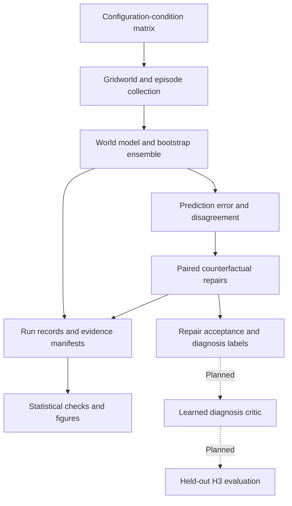

**October17 I10 inherited M3 phase naming qualified.** The [phase basename checkpoint](docs/development/native-producer-qualification/20261017-i10/I10_PHASE_BASENAME_QUALIFICATION.md) records134 passing pure AST kernel cases and the reviewed I2 Source successor. Whole producer/caller integration and the external canonical receipt ABI remain held; Native8, Parser, runtime and science remain unqualified. The I1 expiry hypothesis was refused; I1 is unchanged. Source remains36/45 and frozen STEP08035/45. All prior guidance is preserved below.

---

**October17 I9 recorded M3 semantics tested.** The [M3 semantic checkpoint](docs/development/native-m3-prewrite/20261017-i9/I9_RECORDED_M3_SEMANTICS.md) records pure receipt/facts, whole render, inverse and diff validation for all five stages with synthetic memory evidence. I8 remains the separate required owner/lease/purpose layer; actual producer/caller/IO qualification and real publication remain held. Source remains36/45 and frozen STEP08035/45. All prior guidance is preserved below.

---

**October15 I8 prewrite metadata guards tested.** The [owner/lease/purpose checkpoint](docs/development/native-publisher-admission/20261015-i8/I8_PREWRITE_OWNER_LEASE_PURPOSE.md) records the tested pure owner, existing-lease and separate Source-publication-purpose checks. Full M3 producer semantics and actual caller/IO qualification remain pending; real publication stays held. Source remains36/45 and frozen STEP08035/45. All prior guidance is preserved below.

---

**October15 I7 held publisher IO tested.** The [publisher IO checkpoint](docs/development/native-publisher-implementation/20261015-i7/I7_HELD_PUBLISHER_IO_IMPLEMENTATION.md) records tested owned-file staging, no-overwrite rename and failure preservation, plus held version2 metadata constructors. Actual owner/lease/producer admission and real-family entries remain UNWIRED. No canonical family, Native8, Parser or runtime result was created. Source remains36/45 and frozen STEP08035/45. All prior guidance is preserved below.

---

**October15 I6 pure publication adapter tested.** The [finite-eight metadata report](docs/development/native-publication-adapter/20261015-i6/I6_PUBLICATION_METADATA_ADAPTER.md) records a reviewed batch/reconciliation adapter and separately scoped synthetic memory tests. It reads no measured Source bodies and grants no real publisher, family, lease, Native8, Parser or runtime authority. Existing caller/producer holds stay in place; actual writer/consumer binding is next. Source inventory stays36/45 and frozen STEP08035/45. All prior guidance is preserved below.

---

**October15 I5 interface context Source accepted.** The [generic and phase-peer report](docs/development/native-interface-implementation/20261015-i5/I5_INTERFACE_IMPLEMENTATION.md) records held owner-context successors with the original strong21/39 and seven-link M3 checks preserved. Both Sources remain unrun; publication ABI adapters, Native8 support carrier, Parser result adapter and qualifying consumer bindings remain required. The dated Source inventory stays36/45 and frozen STEP08035/45. All prior guidance is preserved below.

---

**October15 I4 Parser Source port accepted.** The [Parser parent/child report](docs/development/native-parser-implementation/20261015-i4/I4_PARSER_IMPLEMENTATION.md) records owner-direct version2 authority checks with all47 I/O spans and both complete mains preserved. Both Sources remain unrun; accepted Native8 support, I5 interfaces and the version2 saved-result adapter remain explicitly unwired behind false entry guards. Next: separately scope I5 interface work and later reviewed dependency binding. The dated Source inventory stays36/45 and frozen STEP08035/45. All prior guidance is preserved below.

---

**October15 I3 Native8 Source port accepted.** The [native helper/wrapper report](docs/development/native-measurement-implementation/20261015-i3/I3_NATIVE_IMPLEMENTATION.md) records reviewed owner-context/purpose and typed-result Source changes with all15 protected functions and exact8 loop preserved. Both modules remain unrun; dependency interfaces stay held for later I5/I2/I4 qualification and a reviewed I3 successor. Next: separately scope I4 Parser context. The dated Source inventory stays36/45 and frozen STEP08035/45. All prior guidance is preserved below.

---

**October15 I2 family helper Source accepted.** The [M3 family implementation report](docs/development/native-family-implementation/20261015-i2/I2_FAMILY_IMPLEMENTATION.md) records the reviewed owner-context/stage-purpose port, preserved algorithms and explicit future phase ordinals>018. I2 remains unrun; no actual family, stage grant or native/Parser result was created. Next: separately scope I3 Native8 helper/wrapper/API context. The dated Source inventory stays36/45 and frozen STEP08035/45. All prior guidance is preserved below.

---

**October15 I0/I1 implementation accepted.** The [owner-support and lease Source report](docs/development/native-owner-implementation/20261015-i0-i1/I0_I1_IMPLEMENTATION.md) records the new I0 validator's **17 passing memory-only test methods** and independently reviewed I1 Source. I1/native/Parser/original/runtime/scientific entry remains unrun; no real owner grant, lease or new family was issued. Next: separately scope I2 coherent-family Source context. The dated Source inventory stays36/45 and frozen STEP08035/45. All prior guidance is preserved below.

---

**October15 current owner native/Parser design accepted.** Read the [admission design](docs/development/native-admission-design/20261015-owner-v2/NATIVE_ADMISSION_DESIGN.md) before the next implementation. I0 owner-support validation and I1 lease-producer Source context come next; the design creates no helper, lease, family, Native/Parser permission or result. The dated Source inventory stays36/45 and frozen STEP08035/45. All prior guidance is preserved below.

---

**October 15 Source continuation:** [genuine checker peer015 is accepted](docs/development/source-continuation/20261015-checker-peer015/SOURCE_CONTINUATION.md), bringing later local Source progress to **36/45 paths with nine pending**. The frozen STEP080 archive and its complete restore qualification remain at the dated **35/10** state described below. This update publishes Source evidence and continuation guidance.

---

# Beyond Uncertainty

To continue this project on another device, start with [CONTINUE.md](CONTINUE.md).
The repository includes the current source, saved scientific data and an indexed,
byte-preserving workspace snapshot through **STEP080**, including the records
needed by a new coding agent. The default clone is the continuation entry point.

For Windows x64 with an installed general-host **CPython 3.13**, run from the
repository root:

```powershell
git clone https://github.com/RAMZI0TO99/beyond-uncertainty.git
cd beyond-uncertainty
py -3.13 -I -S -B tools/continuation.py verify
py -3.13 -I -S -B tools/continuation.py restore --destination .continuation/workspace
py -3.13 -I -S -B tools/continuation.py verify --workspace .continuation/workspace
py -3.13 tools/setup_dev.py
```

The setup creates a new development environment; it runs no project tests or
training. Verification and restoration use only Python's standard library.
The saved workspace has its original logical paths and file bytes. The current
source family is still **35/45** with ten roles pending; the project is unfinished.
Historical Windows/runtime identities and execution admissions require fresh
device bindings. Read [the environment guide](requirements/README.md) and the
continuation guide before invoking an archived helper or scientific command.

**When a world model makes a bad prediction, does it need more data or a
different model?**

This research project studies that question in controlled gridworld
environments. It distinguishes **estimation failure**, which more experience
may repair, from **hypothesis-class failure**, which may require restoring a
missing feature or increasing model capacity.

The research design uses counterfactual repairs to establish diagnosis labels:
run the candidate repairs and measure what actually improves. Its eventual goal
is a learned diagnosis critic that predicts the required repair. The repository
currently contains the experimental infrastructure and development evidence;
the learned critic and final hypothesis evaluations remain future work.

## Research status

The earlier GitHub snapshot dated **2026-08-23** reported completion of Weeks 4–5
of the infrastructure phase. The [project ledger](PROJECT_STATE.md) now includes
later Week 7/8 development. Read [CONTINUE.md](CONTINUE.md) for the completed
STEP080 Source checkpoint and current continuation boundaries. The
[2026-10-03 closeout](docs/development/CLOSEOUT_2026-10-03.md) retains an earlier
dated status, completed checks and unfinished validation.
Recorded development milestones do not establish the scientific hypotheses.

| Research question | Recorded status |
|---|---|
| **H1:** Does ensemble disagreement track estimation failure? | Development reliability gate passed; confirmatory hypothesis not tested |
| **H2:** Is the disagreement-to-error ratio low under hypothesis-class failure? | Not tested |
| **H3:** Can a learned critic outperform a fitted error/disagreement rule by more than five percentage points? | Not tested; critic training and evaluation remain planned |

The project record also reports **Gate 1 failed its minimum detectable effect
condition**, with its second condition not adjudicable. A development reliability
gate passing does not establish H1 or remove the broader design constraints.
See the [decision ledger](DECISIONS.md) for the recorded reasoning.

## What is implemented

- **Controlled failure conditions:** a gridworld, factored observations, feature
  masking, model-capacity variations, and a scripted data-collection policy.
- **World models and uncertainty:** PyTorch MLPs, episode bootstrap ensembles,
  explicit prediction policies, and disagreement/error measurements.
- **Repair infrastructure:** paired baseline and repair runs, fixed evaluation
  pools, acceptance tests, and threshold-calibration support.
- **Experimental controls:** separate development and confirmatory seeds,
  named random-number streams, group-aware analysis, and immutable evidence
  attempts with manifests and provenance.
- **Statistical tooling:** trend tests, repair acceptance, minimum detectable
  effect simulations, and reproduction of figures from stored logs.
- **Critic preparation:** a frozen feature whitelist and a balancing procedure
  exercised on synthetic labelled inputs. These do not constitute a trained
  diagnosis model or a completed real-label dataset.

## Experimental workflow



The enumerator defines a pool of **300 configuration-conditions in 240 comparison
groups**. These are design units, not 300 completed or successfully labelled
experiments. Actual labels depend on the counterfactual repair results;
ambiguous and undiagnosed conditions can reduce the usable dataset.

## Install and inspect

Use the Windows x64/CPython 3.13 setup at the top of this page and the
[environment guide](requirements/README.md). It creates a fresh isolated CPU
development environment with 37 pinned distributions and this checkout in
editable mode. Inspect the installed distribution metadata with:

```powershell
py -3.13 tools/setup_dev.py --check --venv .venv
```

The package's general declaration is Python 3.11 or newer; Linux/macOS require a
separately resolved compatible environment. The current pinned setup was
validated on Windows x64/CPython 3.13.5. The full research suite was not run for
this portability update. Historical shared-site/CUDA environments are retained
as provenance rather than reused by setup.

The research commands below describe existing tooling. Invoke them only after
reading CONTINUE.md and establishing the current scope and device bindings for
that work; setup does not invoke project modules, tests or scientific cases.

## Reproduce figures from existing evidence

From the repository root:

```bash
.venv/bin/python -m bu.experiments.make_figures
```

This reads the tracked Week 3 pilot summaries and Week 4 gate evidence and
writes the registered figures under `figures/`. It does not train models and
fails if required logs are absent. Figure generation does not turn development
results into confirmatory claims.

| Evidence | What it contains |
|---|---|
| [Week 3 pilot](runs/w3_pilot/attempt-001/) | Development sweep summary and manifest |
| [Week 4 reliability gate](runs/w4_gate/) | Rung-specific evidence, records, metrics, and verdict |
| [Threshold calibration](runs/w4_threshold/attempt-001/) | Calibration record, arrays, and source run records |
| [Timing evidence](runs/w4_timing/attempt-003/) | Timing record and its schema correction note |
| [Tests](tests/) | Checks for identities, pairing, seeds, evidence contracts, models, and statistics |

The Week 3 pilot records a useful complication: prediction error falls as
training data increases, while ensemble disagreement peaks at an intermediate
data size. The evidence and development/confirmatory boundary are retained so
that this observation can be examined without presenting it as a final result.

Most generated outputs are ignored by Git. Selected evidence is explicitly
tracked so a fresh clone can inspect the records behind the documented claims;
see [.gitignore](.gitignore) for the evidence allowlist.

## Reproducibility model

### Four identities

```python
from bu import Arm, Config, UnitSpec

unit = UnitSpec(
    family="missing_feature",
    withheld_features=("shape",),
    n_transitions=500,
)
baseline = Config(unit=unit, arm=Arm("baseline"))
repaired = Config(unit=unit, arm=Arm("feature_repair"))
assert baseline.unit_id == repaired.unit_id
```

| Identity | Meaning |
|---|---|
| `unit_id` | Configuration-condition shared by a failure condition and its repair arms |
| `config_id` | Unit plus the baseline or repair arm |
| `run_id` | Configuration plus stage and seed: the experimental obligation |
| `fit_id` | Configuration plus seed, without stage: the underlying computation |

Keeping fits separate from experimental obligations prevents double-counting
shared work. Statistical analyses use configuration-conditions rather than
treating transitions as independent observations. Comparison groups contain
deliberately related data, so splitting and resampling must respect them.

### Seeds and provenance

Seeds below `CONFIRMATORY_SEED_BASE` (`1000`) are development data and are
excluded from confirmatory analyses, threshold calibration, repair acceptance,
and the critic. Use `require_confirmatory=True` when loading runs for
confirmatory claims; the seed boundary alone is not evidence that a hypothesis
was tested.

Run records store the configuration, seed, Git revision, dirty-tree flag, and
package versions. JSONL metrics flush line by line. For example, this writes a
**synthetic logging example**, not an experimental result:

```python
from bu import Config, RunLogger, UnitSpec, load_runs

cfg = Config(unit=UnitSpec(n_transitions=1000), seed=0)
with RunLogger.start(cfg) as log:
    log.log(epoch=0, split="val", mse=0.42)

df = load_runs("runs")
```

## Code and research documents

| Path | Purpose |
|---|---|
| [src/bu/env/](src/bu/env/) | Gridworld, observations, policy, episode collection |
| [src/bu/models/](src/bu/models/) | World models, training, ensembles, uncertainty |
| [src/bu/experiments/](src/bu/experiments/) | Design matrix, evidence drivers, repairs, figures |
| [src/bu/stats/](src/bu/stats/) | Trend, gate, acceptance, and power-analysis tools |
| [src/bu/critic/](src/bu/critic/) | Feature schema and synthetic-input balancing infrastructure |
| [src/bu/constants.py](src/bu/constants.py) | Preregistered constants; changes require a recorded decision |
| [Research design](docs/thesis_project_plan_v1_2.docx) | Authoritative study design |
| [Execution schedule](docs/thesis_day_by_day_schedule_v1_2.docx) | Planned 20-week schedule |
| [Methodology draft](docs/methodology_chapter.md) | Developing thesis methodology |

## Limits and ongoing work

This is a controlled research environment. Results should not be generalized
to deployed robots, unrelated model classes, or arbitrary data distributions.
The recorded development experiments, threshold calibration, and infrastructure
checks have different purposes from final H1–H3 evaluations. The remaining work
includes the permitted confirmatory experiments, real repair-based labels,
grouped critic training, and held-out comparisons, subject to the recorded gates.

## Maintainer and review handoff

Operational material is kept separately from the visitor-facing overview:

- [PROJECT_STATE.md](PROJECT_STATE.md): dated snapshot, gates, deviations, and open questions.
- [DECISIONS.md](DECISIONS.md): append-only decision ledger.
- [CLAUDE.md](CLAUDE.md) and [SOL_BRIEF.md](SOL_BRIEF.md): existing operational and reviewer handoffs.
- [DELTA_TO_SOL.md](DELTA_TO_SOL.md): review handoff updates.
- [PROJECT_STATE_ARCHIVE.md](PROJECT_STATE_ARCHIVE.md): archived session history.
- [scripts/sol_bundle.sh](scripts/sol_bundle.sh): verification bundle tooling.
- [scripts/sol_evidence_archive.sh](scripts/sol_evidence_archive.sh): tracked threshold-evidence archive tooling.

## License

See [LICENSE](LICENSE) for the repository's existing license.

## Historical development closeout - 2026-10-03

The accepted Week 7/8 recovery source and a dated handoff are available on this
branch. That dated closeout recorded an owner-requested pause and unfinished
model-pool admission, metadata capture and validation suites. Read the
[historical closeout](docs/development/CLOSEOUT_2026-10-03.md) for those completed
checks, archived preparations and the unvalidated D178 draft. The current Source
continuation point is recorded in [CONTINUE.md](CONTINUE.md); this packaging
update makes no new scientific claim.
